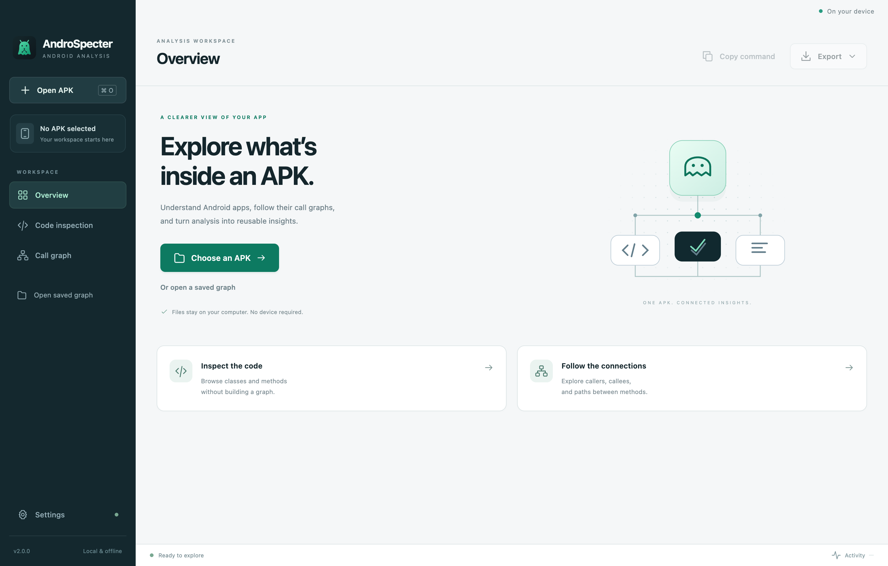

# AndroSpecter Desktop

A local desktop workspace for Android static analysis, built with Electron and
the AndroSpecter CLI. It runs in its own application window on macOS, Windows,
and Linux. There is no HTTP server, account, browser tab, or remote APK upload.

The desktop application is separate from the Java library. Library consumers do
not acquire Electron, Node.js, or a logging provider through their Maven dependency.



The [call-graph view](assets/screenshots/call-graph.png) shows a focused method
neighborhood, searchable methods, path queries, and export options.

## Start from source

Requirements: Node.js 22.12 or newer, Java 17 or newer, and Maven 3.6.3 or newer.
The library version 2.0.0 is published on Maven Central. From the repository root:

```sh
# Build the executable CLI used by the desktop application.
mvn -B -f cli/pom.xml package
cd desktop
npm ci
npm start
```

When developing changes to the library, run `mvn -B install` from the repository
root before rebuilding the CLI. Development uses `cli/target/androspecter-cli.jar`.
Packaged applications include that JAR and a matching Java runtime.

## Your first analysis

1. Choose **Open APK**. The app reads the manifest and displays package/version,
   SDK declarations, requested permissions, and Android components. This needs no SDK.
2. For code or graph analysis, open **Settings** and select your Android SDK's
   `platforms` directory, containing folders such as `android-35/android.jar`.
   Common SDK locations and `ANDROID_HOME` / `ANDROID_SDK_ROOT` are checked automatically.
3. Choose **Code inspection** to search application classes and methods. Invocation
   counting is optional because it loads method bodies.
4. Choose **Call graph**, select an algorithm and optional package prefixes, then
   **Build graph**. Search for a method and follow its callers or callees. Method
   details retain call-site text, edge kind, and Jimple position when available.
5. **Find a path** computes a shortest directed call path from the selected method
   to another signature. **Export** saves JSON, Graphviz DOT, interactive HTML, or
   a JSON run record. **Copy command** copies the corresponding CLI invocation.

**Open saved graph** reads the library's version-one GraphJson format without
reloading an APK or requiring an SDK. Graph JSON and run records are different
formats: open the **JSON data** export for offline graph exploration. A run record
is an envelope containing the data, input identity, settings, command, and diagnostics.

The activity drawer shows actual engine output and the status bar shows elapsed
time. No percentage is inferred from backend log messages. **Cancel** terminates
the active Java process and waits for it to exit. Closing during an operation asks
whether to keep working or cancel and quit.

## Settings and results

- **Java executable:** normally blank. A packaged build uses its bundled runtime;
  source launches check `JAVA_HOME`, macOS JDK discovery, and `PATH`. Set an override
  only to select another Java 17+ executable. Preferences are saved per user.
- **Maximum heap:** limits the Java heap, not the entire process's memory usage.
- **Time limit:** 10–86400 seconds, default 300. The desktop enforces this deadline
  on the analysis process, with forced termination after a short shutdown grace
  period. Java discovery and input snapshotting occur before this analysis deadline.
- APKs are streamed into private temporary snapshots and hashed. A run record's
  SHA-256 identifies the bytes analysed; the copied command refers to the original
  path, which must still contain those bytes to reproduce the run.
- Results remain available for the current APK during the session. Export them
  before selecting another APK, importing another graph, or closing. Temporary APK
  copies and results are removed on normal shutdown; a forced application/OS crash
  can leave temporary `androspecter-run-*` directories.
- Export dialogs protect selected input files and their aliases from replacement.
  Exported records include local paths and diagnostics, so review them before sharing.

## Interpretation and limits

The GUI uses the existing library's analysis semantics:

- Manifest values are declarations. An absent or unresolved value is shown as
  unknown; declared export flags are not Android's effective defaults.
- Graph edges represent static possibilities, not proven executions. A graph
  contains edge endpoints, not every method declared in the APK.
- Package scope produces an induced subgraph. Edges crossing the selected packages
  and paths through excluded packages are omitted. Comma-separated prefixes select
  the union of matching packages and subpackages.
- Graph queries and searches operate on the complete loaded snapshot. Only a bounded
  list and method neighborhood are displayed, with omitted counts shown explicitly.
- CLI success does not prove analysis completeness. Review warnings in **Activity**
  and the exported run record. Imported GraphJson does not record the original APK,
  algorithm, filters, or completion status; the GUI marks those as unknown.
- The first GUI supports metadata, code inspection, and call graphs. Taint analysis
  and instrumentation remain available through the CLI/library; they are not GUI tabs.
- JSON imports/results are capped at 64 MiB to bound transfer and rendering costs.
  Use CLI package filtering for larger graphs. SDK downloads and split-APK merging
  are not part of this desktop application.

## Package a desktop application

Build on each target OS and architecture with a matching full JDK (including
`jlink`). For example, on macOS Apple Silicon, use arm64 Node.js and an arm64 JDK.
From `desktop/`, after building the CLI:

```sh
npm ci
npm run dist:dir   # Application directory, including the CLI and a Java runtime
npm run dist       # macOS/Windows ZIP or Linux tar.gz
```

Build output is in `desktop/dist/`. On macOS the directory build contains
`mac-arm64/AndroSpecter.app` or `mac/AndroSpecter.app`; Windows uses `win-unpacked`
and Linux uses `linux-unpacked`. Open the application/executable normally. Node.js
and a separately installed JDK are not required to run a packaged build.

Packaging is local and never uploads a Maven artifact. This first distribution
has no automatic updater. macOS builds without Developer ID credentials receive
an ad-hoc signature for local testing. Public distribution requires the usual
platform signing/notarization; do not treat local ZIPs as notarized installers.
Build and smoke-test Windows/Linux archives on those operating systems before
publishing them. The runtime and Electron architecture must match the build host;
the packaging script rejects arbitrary cross-compilation flags.

## Validation

```sh
npm test
npm run test:e2e
```

The Node tests exercise child-process failure/cancellation/deadlines, graph queries,
IPC validation, preferences, renderer behavior, and protecting input files during
export. Electron smoke tests open the real desktop window and read the repository's
APK fixture through the real CLI. Set `ANDROSPECTER_ANDROID_PLATFORMS` to enable the
code/graph workflow, export formats, and SDK-free reimport:

```sh
ANDROSPECTER_ANDROID_PLATFORMS=/path/to/android-sdk/platforms npm run test:e2e
```

On PowerShell set `$env:ANDROSPECTER_ANDROID_PLATFORMS` before running the command.
Screenshots go to the ignored `desktop/test-output/` directory. To test a packaged
executable instead of development Electron, set `ANDROSPECTER_TEST_EXECUTABLE` to
its executable path. Tests use an isolated `ANDROSPECTER_USER_DATA` directory and
automate only native file dialogs; the analysis engine remains real.

## Internal structure

`src/main.js` owns native windows, dialogs, and the session. `src/preload.js`
exposes a narrow bridge to the sandboxed renderer. `src/backend.js` runs the CLI
without a shell in a fresh JVM per command, keeping Soot's global state out of
Electron. `src/graph.js` indexes detached JSON for navigation and shortest paths.
The application only loads bundled assets through a private protocol; it does not
grant the renderer Node.js or arbitrary filesystem access.

Shared JavaScript entry points use JSDoc. Changes to the underlying Java library's
public API must retain the repository's [Javadoc requirements](../CONTRIBUTING.md).
